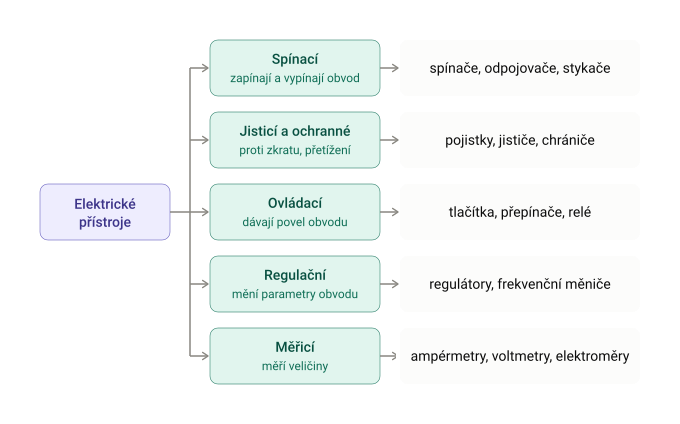
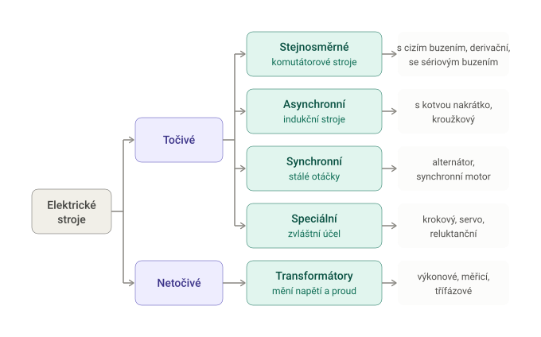

# Rozdělení elektrických strojů a přístrojů

## Elektrické přístroje
Elektrický přístroj je zařízení, které v elektrickém obvodu spíná, ovládá, jistí, reguluje, chrání nebo měří. Na rozdíl od elektrického stroje nepřeměňuje energii z jednoho druhu na jiný (např. mechanickou na elektrickou). Energii jen vede, spíná nebo sleduje.

## Elektrické stroje
Elektrický stroj je zařízení, které slouží k přeměně energie za účasti elektrické energie, a to prostřednictvím elektromagnetického (případně elektrostatického) jevu. Podle toho, co se na co mění, rozlišujeme:

- Generátor: mechanická energie → elektrická
- Motor: elektrická energie → mechanická
- Transformátor: elektrická energie → elektrická energie (jiné parametry, tj. napětí a proud)

### [Zpět na obsah](../README.md)
