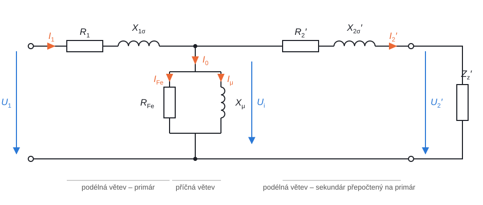
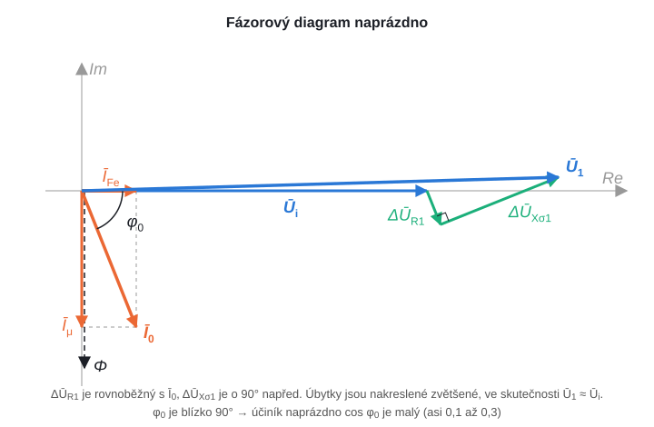
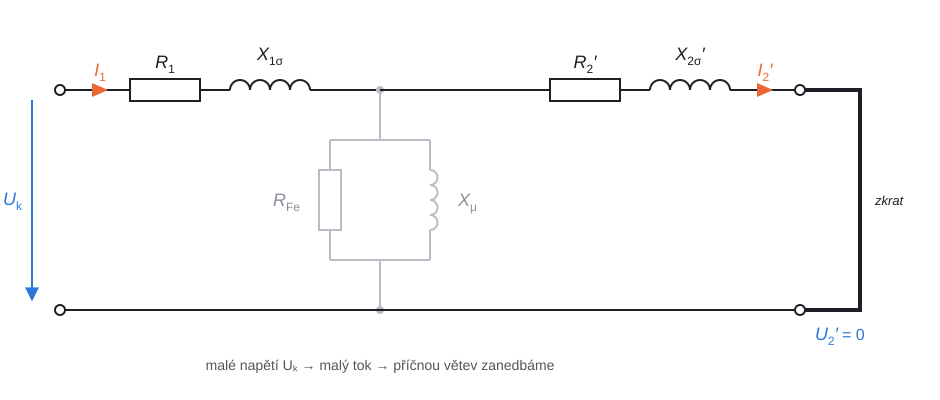
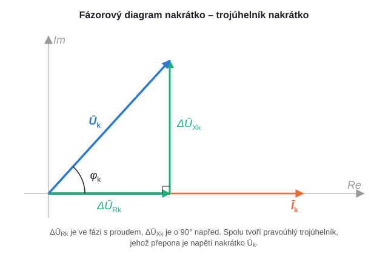
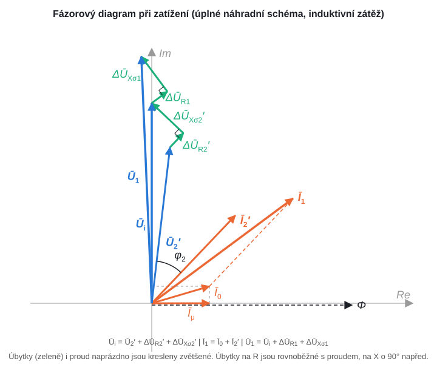
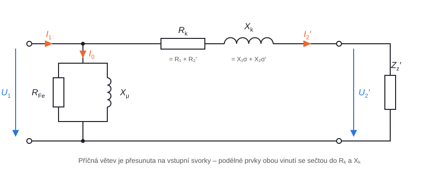
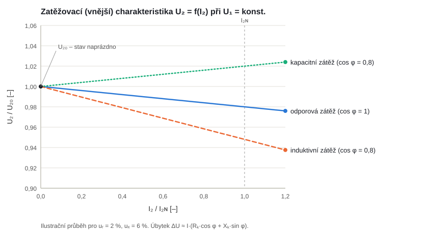

 

# Náhradní schéma transformátoru

Skutečný transformátor je složité zařízení: dvě vinutí spojená jen magneticky přes železné jádro, rozptylové toky, ztráty ve vinutí i v železe. Abychom jeho chování snadno **pochopili a popsali**, nahrazujeme ho jednoduchým elektrickým obvodem, tedy **náhradním schématem**. Na něj pak můžeme použít Kirchhoffovy zákony a nakreslit fázorový diagram.

## Co je náhradní schéma

Náhradní schéma je **model**: obvod složený jen z rezistorů a reaktancí (cívek), který se na svých svorkách chová stejně jako skutečný transformátor.

- každá součástka odpovídá jednomu **fyzikálnímu jevu**,
- z modelu vidíme, kde vznikají ztráty a proč se mění výstupní napětí,
- hodnoty součástek zjistíme dvěma měřeními: **naprázdno** a **nakrátko**.

Náhradní schéma se kreslí pro **jednu fázi**.

Schéma má tvar písmene **T**, a proto se mu říká *T-článek*:

- **podélná větev** (vodorovné prvky) představuje **vinutí**, prochází jí proud zátěže,
- **příčná větev** (svislé prvky uprostřed) představuje **jádro**, prochází jí proud naprázdno $$\overline{I}_0$$.

## Co představují jednotlivé součástky

| Součástka | Fyzikální jev | Co způsobuje |
|---|---|---|
| **R₁**, **R₂′** | odpor vodičů primárního a sekundárního vinutí | **ztráty ve vinutí** (v mědi) $$\Delta P_{Cu}$$, rostou se zatížením |
| **X₁σ**, **X₂σ′** | **rozptylový tok**: část toku se uzavírá vzduchem kolem jednoho vinutí a neprochází druhým | **úbytek napětí** při zatížení, omezuje zkratový proud |
| **R_Fe** | hysterezní ztráty a ztráty vířivými proudy v jádře | **ztráty v železe** $$\Delta P_{Fe}$$, nezávisí na zatížení |
| **X_μ** | **magnetování jádra**, vytváří hlavní tok Φ | odběr magnetizačního (jalového) proudu |

Písmeno σ (sigma) značí *rozptyl*, μ (mí) *magnetizaci* a Fe *železo*.

> **Tip k zapamatování:** podélná větev = **vinutí** (proud zátěže), příčná větev = **jádro** (napětí a tok).

## Přepočet sekundáru na primár

Primár a sekundár mají různá napětí (např. 22 000 V a 400 V) a nejsou galvanicky spojené. Abychom je mohli ve schématu spojit, **přepočítáme sekundární veličiny na primární stranu**, jako by sekundár měl stejný počet závitů jako primár. Přepočtené veličiny značíme **čárkou**: $$\overline{U}_2'$$, $$\overline{I}_2'$$, $$R_2'$$…

Přepočet transformátor fyzikálně nemění, výkony i ztráty zůstanou stejné. Jen ho „přeměříme“ na jednu napěťovou hladinu.

## Fázory a jejich značení

Napětí a proudy kreslíme jako **fázory**: šipky, jejichž délka je efektivní hodnota a úhel je fázový posun. Fázor označujeme **pruhem nad písmenem**, např. $$\overline{U}_1$$, $$\overline{I}_0$$.

Na každé součástce vzniká **úbytek napětí** $$\Delta\overline{U}$$. Pro kreslení diagramů stačí znát dvě pravidla:

| Součástka | Úbytek napětí | Směr fázoru úbytku |
|---|---|---|
| rezistor R | $$\Delta\overline{U}_R$$ | **ve fázi s proudem** (rovnoběžně s fázorem proudu) |
| reaktance X (cívka) | $$\Delta\overline{U}_X$$ | **o 90° před proudem** (kolmo na proud, otočený proti směru hodinových ručiček) |

Stejně tak v příčné větvi: proud $$\overline{I}_{Fe}$$ je **ve fázi** s napětím $$\overline{U}_i$$ a proud $$\overline{I}_\mu$$ je za napětím **o 90° zpožděný**.

## Rovnice náhradního schématu

Pro náhradní schéma napíšeme Kirchhoffovy zákony. Úbytky napětí sčítáme jako fázory, tedy jako šipky.

**II. Kirchhoffův zákon (smyčky):**

a) primární smyčka: napětí zdroje se rozdělí na úbytky na primárním vinutí a indukované napětí

$$
\large \Delta\overline{U}_{R1} + \Delta\overline{U}_{X\sigma1} + \overline{U}_i = \overline{U}_1
$$

b) sekundární smyčka: indukované napětí se rozdělí na úbytky na sekundárním vinutí a výstupní napětí

$$
\large \Delta\overline{U}_{R2}' + \Delta\overline{U}_{X\sigma2}' + \overline{U}_2' = \overline{U}_i
$$

**I. Kirchhoffův zákon (uzly):**

A) uzel, kde se primární proud dělí na proud jádrem a proud do sekundáru

$$
\large \overline{I}_1 = \overline{I}_0 + \overline{I}_2'
$$

B) uzel v příčné větvi, kde se proud naprázdno dělí na činnou a magnetizační složku

$$
\large \overline{I}_0 = \overline{I}_\mu + \overline{I}_{Fe}
$$

Tyto čtyři rovnice platí vždy. V jednotlivých provozních stavech jsou některé veličiny nulové, a rovnice se proto zjednoduší. U každého stavu postupujeme stejně:

1. Napíšeme, **co je nulové** (proud, nebo napětí).
2. **Škrtneme úbytky**, které tím zmizí.
3. Napíšeme **zbylé rovnice**.
4. Podle nich nakreslíme **fázorový diagram**.

---

## Stav naprázdno

Na primár je připojeno **jmenovité napětí** a sekundár je **rozpojený**.

**1. Co je nulové:** sekundárem neteče proud

$$
\large \overline{I}_2' = 0
$$

**2. Co zmizí:** bez proudu nejsou na sekundárním vinutí úbytky

$$
\large \Delta\overline{U}_{R2}' = 0, \qquad \Delta\overline{U}_{X\sigma2}' = 0
$$

**3. Zbylé rovnice:**

$$
\large \Rightarrow \quad \overline{I}_1 = \overline{I}_0, \qquad \overline{U}_2' = \overline{U}_i
$$

$$
\large \Delta\overline{U}_{R1} + \Delta\overline{U}_{X\sigma1} + \overline{U}_i = \overline{U}_1
$$

$$
\large \overline{I}_0 = \overline{I}_\mu + \overline{I}_{Fe}
$$

Proud naprázdno je malý (0,5 až 10 % jmenovitého proudu), proto jsou malé i úbytky na primáru a platí $$\overline{U}_1 \approx \overline{U}_i$$.

**4. Fázorový diagram – postup kreslení:**

1. Fázor $$\overline{U}_i$$ nakreslíme vodorovně (do reálné osy).
2. $$\overline{I}_{Fe}$$ kreslíme **ve fázi** s $$\overline{U}_i$$ (vodorovně, krátký).
3. $$\overline{I}_\mu$$ kreslíme **o 90° zpožděný** za $$\overline{U}_i$$ (svisle dolů).
4. $$\overline{I}_0$$ je jejich součet (úhlopříčka obdélníku).
5. Na konec $$\overline{U}_i$$ navážeme $$\Delta\overline{U}_{R1}$$ **rovnoběžně s** $$\overline{I}_0$$.
6. Na něj navážeme $$\Delta\overline{U}_{X\sigma1}$$ **kolmo na** $$\overline{I}_0$$ (o 90° napřed).
7. Fázor $$\overline{U}_1$$ vede od počátku ke konci posledního úbytku.

Úbytky se v diagramu kreslí **zvětšené**, aby byly vidět. Ve skutečnosti je $$\overline{U}_1$$ téměř stejné jako $$\overline{U}_i$$.

Z diagramu je vidět, že proud $$\overline{I}_0$$ je skoro celý magnetizační: **účiník naprázdno je malý**.

**Co nám dá měření naprázdno:** převod transformátoru ($$p = U_1 / U_{20}$$) a hlavně **ztráty v železe**. Celý příkon naprázdno se spotřebuje v jádře:

$$
\large P_0 \approx \Delta P_{Fe}
$$

Ztráty v železe vznikají stále, kdykoli je transformátor připojený k síti, i když nic nenapájí.

---

## Stav nakrátko

Sekundární svorky jsou **spojené nakrátko**. Rozlišujeme:

1. **Provozní zkrat** (porucha): na primáru je plné napětí a teče **zkratový proud**, mnohonásobně větší než jmenovitý. Transformátor musí odpojit ochrany.
2. **Měření nakrátko** (zkouška): napětí zvyšujeme od nuly jen tak, aby tekl **jmenovitý proud**. Toto malé napětí je **napětí nakrátko** $$\overline{U}_k$$.

**1. Co je nulové:** výstupní napětí

$$
\large \overline{U}_2' = 0
$$

Napětí $$\overline{U}_k$$ je malé, proto je malé i $$\overline{U}_i$$ a proud jádrem je zanedbatelný:

$$
\large \overline{I}_0 \approx 0 \quad \Rightarrow \quad \overline{I}_1 = \overline{I}_2' = \overline{I}_k
$$

**2. Co zmizí:** příčnou větev můžeme vynechat. Zbudou jen podélné prvky obou vinutí, kterými teče stejný proud.

**3. Zbylé rovnice:** dosadíme rovnici b) do a). Úbytky obou vinutí se sečtou:

$$
\large \Delta\overline{U}_{R1} + \Delta\overline{U}_{X\sigma1} + \Delta\overline{U}_{R2}' + \Delta\overline{U}_{X\sigma2}' = \overline{U}_k
$$

Úbytky na odporech i na reaktancích obou vinutí můžeme spojit do dvou:

$$
\large \Delta\overline{U}_{Rk} + \Delta\overline{U}_{Xk} = \overline{U}_k
$$

**4. Fázorový diagram – postup kreslení:**

1. Fázor proudu $$\overline{I}_k$$ nakreslíme vodorovně.
2. $$\Delta\overline{U}_{Rk}$$ kreslíme **ve fázi** s proudem (vodorovně).
3. Na jeho konec navážeme $$\Delta\overline{U}_{Xk}$$ **kolmo nahoru** (o 90° napřed).
4. $$\overline{U}_k$$ vede od počátku ke konci, je to **přepona pravoúhlého trojúhelníku**.

Tomuto trojúhelníku se říká **trojúhelník nakrátko**. Uvidíme ho znovu ve stavu při zatížení.

**Co nám dá měření nakrátko:** příkon se spotřebuje ve vinutí, protože jádro je při malém napětí skoro bez ztrát:

$$
\large P_k \approx \Delta P_{Cu}
$$

Napětí nakrátko se udává v procentech jmenovitého napětí a je na **štítku** transformátoru:

$$
\large u_k = \frac{U_k}{U_{1N}} \cdot 100\ \%
$$

Typicky je $$u_k$$ 4 až 6 % u distribučních transformátorů. Napětí nakrátko říká, kolikrát je zkratový proud větší než jmenovitý: při $$u_k = 5\ \%$$ je zkratový proud **20× větší** než jmenovitý. Malé $$u_k$$ znamená malý úbytek napětí při zatížení, ale velký zkratový proud.

---

## Stav při zatížení

Na sekundár je připojena **zátěž** a platí všechny čtyři rovnice náhradního schématu.

### Úplný fázorový diagram

Pro úplné náhradní schéma platí všechny čtyři rovnice. Diagram kreslíme od zátěže směrem ke zdroji:

1. Nakreslíme výstupní napětí $$\overline{U}_2'$$ a proud $$\overline{I}_2'$$, který je u induktivní zátěže **zpožděný** o úhel φ₂.
2. Na konec $$\overline{U}_2'$$ navážeme $$\Delta\overline{U}_{R2}'$$ (**rovnoběžně** s $$\overline{I}_2'$$) a $$\Delta\overline{U}_{X\sigma2}'$$ (**kolmo**, o 90° napřed). Dostaneme indukované napětí $$\overline{U}_i$$ (rovnice b).
3. Magnetický tok $$\overline{\Phi}$$ je o 90° **za** napětím $$\overline{U}_i$$. Ve směru toku kreslíme $$\overline{I}_\mu$$, ve směru $$\overline{U}_i$$ kreslíme $$\overline{I}_{Fe}$$ a jejich součtem je $$\overline{I}_0$$ (uzel B).
4. Primární proud je součet $$\overline{I}_1 = \overline{I}_0 + \overline{I}_2'$$ (uzel A). Na konec $$\overline{I}_0$$ přiložíme $$\overline{I}_2'$$ (čárkovaně).
5. Na konec $$\overline{U}_i$$ navážeme $$\Delta\overline{U}_{R1}$$ (**rovnoběžně** s $$\overline{I}_1$$) a $$\Delta\overline{U}_{X\sigma1}$$ (**kolmo**, o 90° napřed). Výsledkem je napětí zdroje $$\overline{U}_1$$ (rovnice a).

Z diagramu je vidět, že napětí postupně „ubývá“ od zdroje k zátěži: $$\overline{U}_1$$ je delší než $$\overline{U}_i$$ a to je delší než $$\overline{U}_2'$$. Proud $$\overline{I}_0$$ je proti proudu zátěže malý, proto je $$\overline{I}_1$$ skoro stejný jako $$\overline{I}_2'$$. Toho využívá zjednodušené schéma.

### Zjednodušené náhradní schéma

Proud naprázdno $$\overline{I}_0$$ je proti proudu zátěže malý. Příčnou větev proto **přesuneme na vstupní svorky** a podélné prvky obou vinutí spojíme do $$R_k$$ a $$X_k$$, tedy do stejných prvků jako při měření nakrátko.

$$
\large \overline{I}_1 \approx \overline{I}_2'
$$

$$
\large \Delta\overline{U}_{Rk} + \Delta\overline{U}_{Xk} + \overline{U}_2' = \overline{U}_1
$$

Napětí zdroje se rozdělí na **výstupní napětí** a **úbytek napětí uvnitř transformátoru**.

### Fázorový diagram při induktivní zátěži – postup kreslení

1. Fázor výstupního napětí $$\overline{U}_2'$$ nakreslíme vodorovně.
2. Proud $$\overline{I}_2'$$ je u induktivní zátěže **zpožděný** o úhel φ₂ (míří šikmo dolů).
3. Na konec $$\overline{U}_2'$$ navážeme $$\Delta\overline{U}_{Rk}$$ **rovnoběžně s proudem**.
4. Na něj navážeme $$\Delta\overline{U}_{Xk}$$ **kolmo na proud** (o 90° napřed).
5. $$\overline{U}_1$$ vede od počátku ke konci posledního úbytku.

Úbytky tvoří **trojúhelník nakrátko**, jen je natočený podle proudu zátěže.

Co z diagramu vyčteme:

- **odporová zátěž** (proud ve fázi s napětím): trojúhelník leží „naplocho“, $$\overline{U}_1$$ je jen o málo delší než $$\overline{U}_2'$$. Napětí při zatížení klesne málo.
- **induktivní zátěž** (proud zpožděný): trojúhelník se natočí tak, že úbytek míří skoro ve směru $$\overline{U}_2'$$. Napětí klesne **nejvíc**.
- **kapacitní zátěž** (proud předbíhá): $$\Delta\overline{U}_{Xk}$$ míří dozadu a $$\overline{U}_2'$$ může být **delší** než $$\overline{U}_1$$. Výstupní napětí se při zatížení **zvýší**.

### Ztráty při zatížení

Při zatížení vznikají obě složky ztrát:

- **ztráty v železe** $$\Delta P_{Fe}$$ jsou **stálé**, stejné jako naprázdno,
- **ztráty ve vinutí** $$\Delta P_{Cu}$$ **rostou se zatížením**, s druhou mocninou proudu.

$$
\large P_1 = P_2 + \Delta P_{Fe} + \Delta P_{Cu}
$$

---

## Shrnutí tří stavů

| | Naprázdno | Nakrátko (měření) | Při zatížení |
|---|---|---|---|
| sekundár | rozpojený | zkratovaný | připojena zátěž |
| co je nulové | $$\overline{I}_2' = 0$$ | $$\overline{U}_2' = 0$$, $$\overline{I}_0 \approx 0$$ | nic |
| co zanedbáme | úbytky na primáru | příčnou větev (jádro) | příčnou větev přesuneme na vstup |
| rovnice | $$\overline{I}_1 = \overline{I}_0$$, $$\overline{U}_2' = \overline{U}_i$$ | $$\Delta\overline{U}_{Rk} + \Delta\overline{U}_{Xk} = \overline{U}_k$$ | $$\Delta\overline{U}_{Rk} + \Delta\overline{U}_{Xk} + \overline{U}_2' = \overline{U}_1$$ |
| příkon | $$P_0 \approx \Delta P_{Fe}$$ | $$P_k \approx \Delta P_{Cu}$$ | $$P_1 = P_2 + \Delta P_{Fe} + \Delta P_{Cu}$$ |
| co zjistíme | převod, ztráty v železe | $$u_k$$, ztráty ve vinutí | úbytek napětí, účinnost |

## Kontrolní otázky

1. Co je náhradní schéma a proč ho používáme?
2. Které součástky tvoří podélnou a které příčnou větev? Jaký fyzikální jev představuje každá z nich?
3. Proč musíme sekundární veličiny přepočítat na primár?
4. Jakým směrem kreslíme ve fázorovém diagramu úbytek napětí na rezistoru a jakým na reaktanci?
5. Napište rovnice podle II. Kirchhoffova zákona pro primární a sekundární smyčku.
6. Která veličina je nulová ve stavu naprázdno? Jak se tím zjednoduší rovnice?
7. Proč při měření naprázdno považujeme celý příkon za ztráty v železe?
8. Proč nemůžeme měřit nakrátko při jmenovitém napětí? Co je napětí nakrátko?
9. Co je trojúhelník nakrátko a kde ho najdeme ve fázorovém diagramu při zatížení?
10. Proč při induktivní zátěži klesá výstupní napětí víc než při odporové? Co se může stát při kapacitní zátěži?

### [Zpět na obsah](../README.md)
