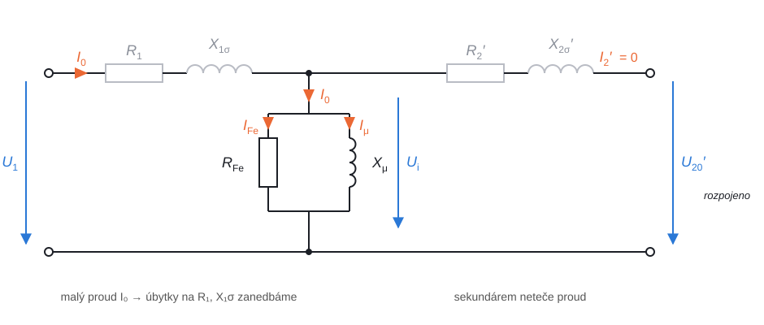
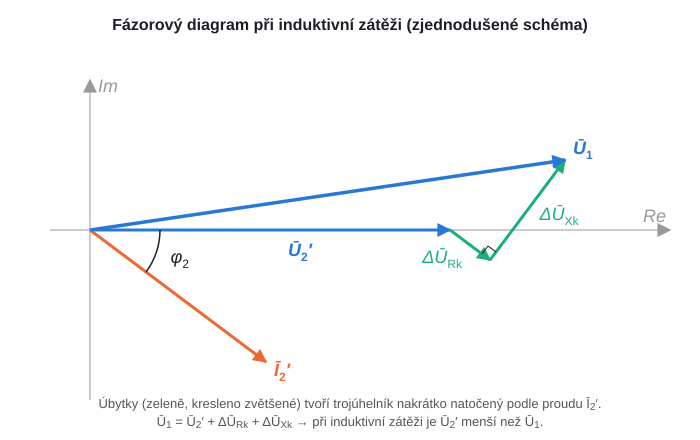

 

# Náhradní schéma transformátoru

Skutečný transformátor je z hlediska výpočtů složité zařízení: dvě vinutí, která jsou spolu spojená jen magneticky přes železné jádro, rozptylové toky, ztráty ve vinutí i v železe. Abychom mohli jeho chování v různých podmínkách lépe **počítat** s použitím Ohmova zákona, Kirchhofových rovnic atd., nahrazujeme ho jednoduchým elektrickým obvodem, tedy **náhradním schématem**.

## Co je náhradní schéma

Náhradní schéma je **model**: obvod složený jen z rezistorů a reaktancí (cívek), který se na svých svorkách chová stejně jako skutečný transformátor. Při stejném napětí U₁ z něj vychází stejné proudy, stejná výstupní napětí i stejné ztráty.

Výhody náhradního schématu:

- transformátor můžeme řešit běžnými metodami (Ohmův zákon, Kirchhoffovy zákony),
- každá součástka odpovídá jednomu **fyzikálnímu jevu**, 
- hodnoty součástek v náhradním schématu můžeme zjistit dvěma jednoduchými měřeními: **naprázdno** a **nakrátko**,
- z modelu můžeme předem spočítat úbytek napětí, ztráty, účinnost nebo zkratový proud.

Náhradní schéma se kreslí pro **jednu fázi**. U třífázového transformátoru počítáme s fázovými hodnotami napětí a proudu.

Schéma má tvar písmene **T**, a proto se mu říká *T-článek*. Skládá se z:

- **podélné větve** (vodorovné prvky): odpory a rozptylové reaktance vinutí, kterými prochází proud zátěže,
- **příčné větve** (svislé prvky uprostřed): popisuje magnetický obvod (jádro). Prochází jí proud naprázdno I₀.

## Co představují jednotlivé součástky

Představme si nejprve **ideální transformátor**: vinutí bez odporu, veškerý tok prochází oběma vinutími a jádro nemá žádné ztráty a nepotřebuje žádný proud na magnetování. Skutečný transformátor se od ideálního liší ve čtyřech věcech a každou z nich ve schématu vyjadřuje jedna dvojice součástek:

| Součástka | Fyzikální jev | Co způsobuje |
|---|---|---|
| **R₁**, **R₂′** | činný odpor vodičů primárního a sekundárního vinutí (měď, hliník) | **ztráty ve vinutí** (Jouleovo teplo $$R \cdot I^2$$), tzv. ztráty v mědi $$\Delta P_{Cu}$$, které rostou s druhou mocninou proudu |
| **X₁σ**, **X₂σ′** | **rozptylový magnetický tok**: část toku se uzavírá vzduchem kolem jednoho vinutí a neprochází druhým | **úbytek napětí** při zatížení, omezuje zkratový proud. Nevznikají na nich ztráty, jen jalový výkon |
| **R_Fe** | ztráty v železe jádra, tj. **hysterezní ztráty** a **ztráty vířivými proudy** | **ztráty v železe** $$\Delta P_{Fe}$$, které závisí na napětí (toku), ne na zatížení |
| **X_μ** | **magnetování jádra**: proud I_μ, který v jádru vytváří hlavní magnetický tok Φ | odběr **jalového (magnetizačního) výkonu** ze sítě |

Písmeno σ (sigma) značí *rozptyl*, μ (mí) *magnetizaci* a Fe *železo* (magnetický obvod).

Napětí **Uᵢ** na příčné větvi je napětí indukované hlavním magnetickým tokem (viz kapitola [Princip funkce](Transformatory_uvod.md)). Proud naprázdno se skládá ze dvou složek:

$$
\large \mathbf{I_0} = \mathbf{I_{Fe}} + \mathbf{I_\mu}
$$

- $$I_{Fe}$$ je činná složka (ve fázi s napětím), která kryje ztráty v železe,
- $$I_\mu$$ je magnetizační (jalová) složka, která je za napětím zpožděná o 90° a vytváří tok.

> **Tip k zapamatování:** podélná větev = **vinutí** (proud zátěže), příčná větev = **jádro** (napětí a tok).

## Přepočet sekundární strany na primární

Primár a sekundár skutečného transformátoru nejsou **galvanicky spojené** a pracují s různými napětími, např. 22 000 V a 400 V. Kdybychom je ve schématu jen spojili drátem, byla by to chyba. Proto **sekundární veličiny přepočítáme na primární stranu**, jako by měl sekundár stejný počet závitů jako primár ($$N_2' = N_1$$). Přepočtené veličiny značíme **čárkou**: $$U_2'$$, $$I_2'$$, $$R_2'$$...

Přepočet využívá převod transformátoru

$$
\large p = \frac{N_1}{N_2} = \frac{U_1}{U_2}
$$

a musí splnit jedinou podmínku: **výkony a ztráty se přepočtem nesmí změnit**. Transformátor přepočtem jen „přeměříme", fyzikálně zůstává stejný.

| Veličina | Přepočet | Proč |
|---|---|---|
| napětí | $$U_2' = p \cdot U_2$$ | napětí se transformuje jako počet závitů |
| proud | $$I_2' = \dfrac{I_2}{p}$$ | aby zůstal stejný výkon $$U_2' I_2' = U_2 I_2$$ |
| odpor | $$R_2' = p^2 \cdot R_2$$ | aby zůstaly stejné ztráty $$R_2' I_2'^2 = R_2 I_2^2$$ |
| reaktance | $$X_{2\sigma}' = p^2 \cdot X_{2\sigma}$$ | stejný jalový výkon |
| impedance zátěže | $$Z_z' = p^2 \cdot Z_z$$ | stejně jako odpor: $$Z = U/I$$, tedy $$p \cdot p$$ |

Po přepočtu má celé schéma jednu napěťovou hladinu a obě strany můžeme spojit. Výsledky na skutečném sekundáru získáme zpětným přepočtem: $$U_2 = U_2' / p$$ a $$I_2 = p \cdot I_2'$$.

### Rovnice náhradního schématu

Podle Kirchhoffových zákonů platí (fázory, tučně):

$$
\large \mathbf{U_1} = (R_1 + jX_{1\sigma}) \cdot \mathbf{I_1} + \mathbf{U_i}
$$

$$
\large \mathbf{U_i} = (R_2' + jX_{2\sigma}') \cdot \mathbf{I_2'} + \mathbf{U_2'}
$$

$$
\large \mathbf{I_1} = \mathbf{I_0} + \mathbf{I_2'}
$$

Poslední rovnice říká, že primární proud je součtem proudu naprázdno (pro jádro) a přepočteného proudu zátěže.

---

## Stav naprázdno

Ve stavu naprázdno je na primár připojeno **jmenovité napětí U₁ₙ** a sekundární svorky jsou **rozpojené** (žádná zátěž):

- $$I_2 = 0$$, sekundárním vinutím neteče proud,
- primárem teče jen malý **proud naprázdno I₀**, typicky 0,5 až 10 % jmenovitého proudu (čím větší transformátor, tím menší procento),
- protože je I₀ malý, úbytky napětí i ztráty na R₁ a X₁σ jsou zanedbatelné a platí $$U_1 \approx U_i$$,
- na výstupu naměříme napětí naprázdno $$U_{20}$$.

**Důležitý závěr:** příkon naprázdno P₀ připadá prakticky celý na **ztráty v železe**:

$$
\large P_0 \approx \Delta P_{Fe}
$$

Ztráty v železe závisí na napětí a frekvenci, **ne na zatížení**. Transformátor připojený k síti je má stále, i když nic nenapájí.

Proud I₀ je téměř celý magnetizační (jalový), proto je **účiník naprázdno malý** (φ₀ je blízko 90°).

### Měření naprázdno a co z něj zjistíme

Na primár připojíme jmenovité napětí a měříme U₁, I₀, P₀ (wattmetr) a U₂₀ (voltmetr na sekundáru).

| Výpočet | Vzorec |
|---|---|
| převod | $$p = \dfrac{U_1}{U_{20}}$$ |
| účiník naprázdno | $$\cos\varphi_0 = \dfrac{P_0}{U_1 \cdot I_0}$$ |
| činná a jalová složka proudu | $$I_{Fe} = I_0 \cos\varphi_0, \qquad I_\mu = I_0 \sin\varphi_0$$ |
| prvky příčné větve | $$R_{Fe} = \dfrac{U_1}{I_{Fe}} = \dfrac{U_1^2}{P_0}, \qquad X_\mu = \dfrac{U_1}{I_\mu}$$ |
| proud naprázdno v % | $$i_0 = \dfrac{I_0}{I_{1N}} \cdot 100\ \%$$ |

**Příklad:** Jednofázový transformátor 10 kVA, 1000 V / 100 V ($$I_{1N} = 10\ \text{A}$$). Při měření naprázdno: $$U_1 = 1000\ \text{V}$$, $$I_0 = 0{,}4\ \text{A}$$, $$P_0 = 80\ \text{W}$$, $$U_{20} = 100\ \text{V}$$.

- $$p = 1000 / 100 = 10$$
- $$\cos\varphi_0 = 80 / (1000 \cdot 0{,}4) = 0{,}2$$
- $$I_{Fe} = 0{,}4 \cdot 0{,}2 = 0{,}08\ \text{A}$$, $$I_\mu = 0{,}4 \cdot 0{,}98 = 0{,}39\ \text{A}$$
- $$R_{Fe} = 1000^2 / 80 = 12\,500\ \Omega$$, $$X_\mu = 1000 / 0{,}392 \approx 2\,550\ \Omega$$
- $$i_0 = 0{,}4 / 10 \cdot 100 = 4\ \%$$, ztráty v železe $$\Delta P_{Fe} \approx 80\ \text{W}$$

---

## Stav nakrátko

Ve stavu nakrátko jsou sekundární svorky **spojené** vodičem bez odporu, takže $$U_2 = 0$$. Je třeba rozlišit dvě situace:

1. **Provozní zkrat** (porucha): na primáru je plné jmenovité napětí a vinutím teče **zkratový proud**, mnohonásobně větší než jmenovitý. Transformátor se rychle přehřívá a působí na něj velké elektrodynamické síly. Musí ho odpojit ochrany.
2. **Měření nakrátko** (zkouška): napětí na primáru zvyšujeme od nuly jen tak, aby vinutím tekl právě **jmenovitý proud** $$I_{1N}$$. Toto snížené napětí se nazývá **napětí nakrátko Uₖ**.

Při měření nakrátko je napětí malé (jen několik procent U₁ₙ), proto je v jádru malý tok a malý proud I₀. **Příčnou větev zanedbáme** a zbudou jen podélné prvky obou vinutí. Proto:

$$
\large P_k \approx \Delta P_{Cu}
$$

Příkon nakrátko odpovídá **ztrátám ve vinutí při jmenovitém proudu**.

### Napětí nakrátko

Napětí nakrátko se udává v procentech jmenovitého napětí a je uvedeno na **štítku** transformátoru:

$$
\large u_k = \frac{U_k}{U_{1N}} \cdot 100\ \%
$$

Typicky $$u_k = 4$$ až $$6\ \%$$ u distribučních transformátorů a 10 až 15 % u velkých síťových transformátorů. Napětí nakrátko je důležité, protože:

- určuje velikost **ustáleného zkratového proudu** při jmenovitém napětí:

$$
\large I_k = I_N \cdot \frac{100}{u_k}
$$

  Například při $$u_k = 5\ \%$$ je $$I_k = 20 \cdot I_N$$.
- určuje, jak moc klesá napětí při zatížení (malé uₖ znamená „tvrdý" zdroj s malým úbytkem, ale velký zkratový proud),
- při **paralelním chodu** musí mít transformátory přibližně stejné uₖ.

### Měření nakrátko a co z něj zjistíme

Měříme Uₖ, I₁ₙ a Pₖ (wattmetr). Prvky podélné větve sečteme do **impedance nakrátko**:

| Výpočet | Vzorec |
|---|---|
| impedance nakrátko | $$Z_k = \dfrac{U_k}{I_{1N}}$$ |
| odpor nakrátko | $$R_k = \dfrac{P_k}{I_{1N}^2} = R_1 + R_2'$$ |
| reaktance nakrátko | $$X_k = \sqrt{Z_k^2 - R_k^2} = X_{1\sigma} + X_{2\sigma}'$$ |
| účiník nakrátko | $$\cos\varphi_k = \dfrac{P_k}{U_k \cdot I_{1N}}$$ |

Pokud potřebujeme jednotlivé prvky, obvykle se počítá s rozdělením napůl: $$R_1 \approx R_2' \approx R_k/2$$, $$X_{1\sigma} \approx X_{2\sigma}' \approx X_k/2$$.

**Příklad (pokračování):** Transformátor 10 kVA, 1000 V / 100 V. Při měření nakrátko: $$U_k = 50\ \text{V}$$, $$I_{1N} = 10\ \text{A}$$, $$P_k = 200\ \text{W}$$.

- $$u_k = 50 / 1000 \cdot 100 = 5\ \%$$
- $$Z_k = 50 / 10 = 5\ \Omega$$, $$R_k = 200 / 10^2 = 2\ \Omega$$, $$X_k = \sqrt{5^2 - 2^2} \approx 4{,}58\ \Omega$$
- zkratový proud při jmenovitém napětí: $$I_{1k} = 10 \cdot 100/5 = 200\ \text{A}$$, na sekundáru $$I_{2k} = 2000\ \text{A}$$
- ztráty ve vinutí při jmenovitém proudu: $$\Delta P_{Cu} \approx 200\ \text{W}$$

Výsledek $$R_k = 2\ \Omega$$ odpovídá např. $$R_1 = 1\ \Omega$$ a $$R_2' = 1\ \Omega$$, tedy hodnotě z příkladu přepočtu.

---

## Stav při zatížení

Při zatížení je na sekundár připojena impedance zátěže $$Z_z$$ (ve schématu přepočtená $$Z_z'$$). Platí úplné náhradní schéma (T-článek) a všechny jeho rovnice:

- sekundárem teče proud $$I_2$$ daný zátěží, primárem $$\mathbf{I_1} = \mathbf{I_0} + \mathbf{I_2'}$$,
- protože $$I_0$$ je proti jmenovitému proudu malý, platí přibližně $$I_1 \approx I_2' = I_2/p$$,
- na podélné větvi vzniká **úbytek napětí**, takže výstupní napětí se se zatížením mění,
- vznikají ztráty v železe (stálé) i ztráty ve vinutí (podle zatížení).

### Zjednodušené náhradní schéma

Protože I₀ je malý, můžeme pro výpočty při zatížení **přesunout příčnou větev na vstupní svorky**. Podélné prvky obou vinutí pak leží za sebou a sečteme je do $$R_k$$ a $$X_k$$, tedy právě do hodnot, které jsme získali měřením nakrátko.

$$
\large \mathbf{U_1} = \mathbf{U_2'} + (R_k + jX_k) \cdot \mathbf{I_2'}
$$

### Úbytek napětí a fázorový diagram

Úbytek napětí na Rₖ je ve fázi s proudem, úbytek na Xₖ je o 90° napřed. Velikost úbytku napětí přibližně spočítáme:

$$
\large \Delta U \approx I_2' \cdot (R_k \cos\varphi_2 + X_k \sin\varphi_2)
$$

kde φ₂ je fázový posun zátěže. U kapacitní zátěže je $$\sin\varphi_2$$ záporný.

- **odporová zátěž** (cos φ = 1): malý úbytek, jen na Rₖ,
- **induktivní zátěž** (motory, nejčastější případ): největší úbytek, napětí klesá výrazně,
- **kapacitní zátěž**: úbytek na Xₖ působí opačně a výstupní napětí může být **vyšší** než naprázdno.

**Příklad (pokračování):** Transformátor zatížíme jmenovitým proudem $$I_2' = 10\ \text{A}$$ při $$\cos\varphi_2 = 0{,}8$$ induktivně ($$\sin\varphi_2 = 0{,}6$$):

- $$\Delta U \approx 10 \cdot (2 \cdot 0{,}8 + 4{,}58 \cdot 0{,}6) = 10 \cdot 4{,}35 \approx 43{,}5\ \text{V}$$ (4,35 %)
- $$U_2' \approx 1000 - 43{,}5 = 956{,}5\ \text{V}$$, tedy na skutečném sekundáru $$U_2 = 956{,}5 / 10 \approx 95{,}7\ \text{V}$$

### Ztráty při zatížení

Z obou měření známe obě složky ztrát. Ztráty ve vinutí rostou s druhou mocninou zatížení. Označíme-li poměrné zatížení $$\beta = I / I_N$$, platí:

$$
\large \Delta P = \Delta P_{Fe} + \beta^2 \cdot \Delta P_{Cu} \approx P_0 + \beta^2 \cdot P_k
$$

V našem příkladu při jmenovitém zatížení ($$\beta = 1$$) a výkonu $$P_2 = 10\,000 \cdot 0{,}8 = 8000\ \text{W}$$:

$$
\large \Delta P = 80 + 1^2 \cdot 200 = 280\ \text{W}, \qquad \eta = \frac{P_2}{P_2 + \Delta P} = \frac{8000}{8280} \approx 96{,}6\ \%
$$

---

## Shrnutí tří stavů

| | Naprázdno | Nakrátko (měření) | Při zatížení |
|---|---|---|---|
| sekundár | rozpojený, $$I_2 = 0$$ | zkratovaný, $$U_2 = 0$$ | připojena zátěž $$Z_z$$ |
| napětí na primáru | jmenovité $$U_{1N}$$ | snížené $$U_k$$ (několik %) | jmenovité $$U_{1N}$$ |
| proud primáru | malý $$I_0$$ (0,5 až 10 % $$I_N$$) | jmenovitý $$I_{1N}$$ | podle zátěže, $$I_1 \approx I_2/p$$ |
| co zanedbáme | podélnou větev ($$R_1, X_{1\sigma}$$) | příčnou větev ($$R_{Fe}, X_\mu$$) | (v zjednodušeném schématu přesuneme příčnou větev na vstup) |
| naměřený příkon | $$P_0 \approx \Delta P_{Fe}$$ | $$P_k \approx \Delta P_{Cu}$$ | $$P_1 = P_2 + \Delta P_{Fe} + \beta^2 \Delta P_{Cu}$$ |
| co zjistíme | $$p,\ i_0,\ R_{Fe},\ X_\mu$$ | $$u_k,\ R_k,\ X_k,\ I_k$$ | úbytek napětí, účinnost |

## Kontrolní otázky

1. Co je náhradní schéma a proč ho používáme?
2. Které součástky tvoří podélnou a které příčnou větev? Jaký fyzikální jev představuje každá z nich?
3. Proč musíme sekundární veličiny přepočítat na primár? Jak se přepočítá napětí, proud a odpor?
4. Proč se odpor přepočítává s druhou mocninou převodu?
5. Proč při měření naprázdno považujeme celý příkon za ztráty v železe?
6. Proč nemůžeme měřit nakrátko při jmenovitém napětí? Co je napětí nakrátko?
7. Transformátor má $$u_k = 6\ \%$$ a $$I_N = 100\ \text{A}$$. Jaký je zkratový proud?
8. Proč při induktivní zátěži klesá výstupní napětí víc než při odporové? Co se může stát při kapacitní zátěži?
9. Transformátor 1000 V / 100 V má $$R_2 = 0{,}02\ \Omega$$. Jaký je přepočtený odpor $$R_2'$$?

### [Zpět na obsah](../README.md)
