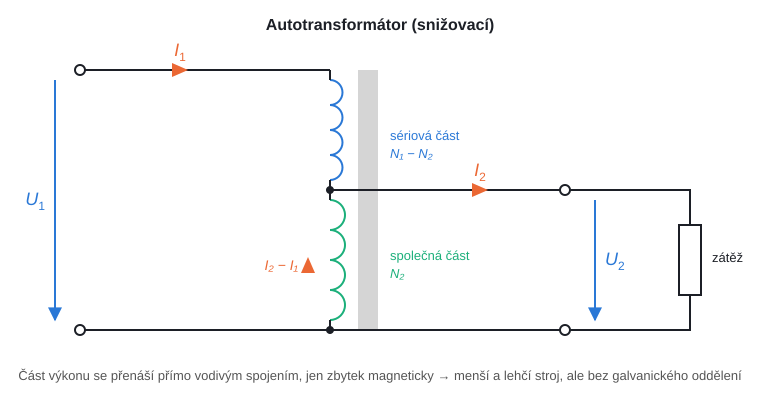
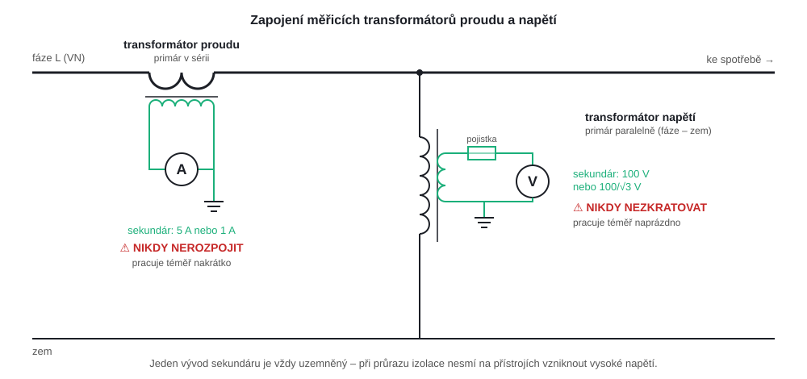

 

# Speciální transformátory

Většina transformátorů v síti slouží k jedinému účelu: změnit napětí s co nejmenšími ztrátami. Některé transformátory se ale navrhují pro jiný hlavní úkol: **ochranu před úrazem**, **svařování** nebo **měření**. Princip zůstává stejný (dvě vinutí, společný magnetický tok, převod $$p = N_1/N_2$$), ale konstrukce se přizpůsobí tomu, co od transformátoru chceme.

## Oddělovací transformátory

Oddělovací transformátor **galvanicky odděluje** spotřebič od napájecí sítě. Mezi primárním a sekundárním vinutím není žádné vodivé spojení a energie se přenáší jen magnetickým tokem. Převod bývá **1 : 1** (např. 230 V / 230 V), protože nejde o změnu napětí, ale o oddělení.

**Proč to chrání před úrazem:** v běžné síti je střední vodič spojený se zemí. Když se člověk dotkne fázového vodiče, proud se uzavře přes jeho tělo a zem zpět ke zdroji. Sekundární obvod oddělovacího transformátoru ale se zemí spojený **není**. Při dotyku jednoho vodiče se proto obvod přes tělo neuzavře a proud neteče.

Aby ochrana fungovala, musí platit:

- sekundární obvod se **nesmí uzemnit** a nesmí být spojený s jiným obvodem,
- k jednomu transformátoru se má připojit jen **jeden spotřebič** (při dvou spotřebičích by souběžná porucha izolace na každém z nich mohla vytvořit nebezpečné napětí mezi jejich kryty),
- vinutí musí být od sebe oddělená **dvojitou nebo zesílenou izolací**, aby se při poruše primární napětí nepřeneslo na sekundár,
- sekundární obvod má být krátký a dobře izolovaný, aby měl malou kapacitu vůči zemi.

Použití: napájení ručního nářadí ve stísněných kovových prostorách (kotle, nádrže), servis a opravy elektrických zařízení, zásuvky pro holicí strojky v koupelnách, zdravotnické prostory.

## Autotransformátory

Autotransformátor má **jen jedno vinutí** s odbočkou. Část vinutí je společná primární i sekundární straně (**společná část**), zbytek je zapojený jen v primárním obvodu (**sériová část**).

Převod platí stejně jako u běžného transformátoru:

$$
\large p = \frac{U_1}{U_2} = \frac{N_1}{N_2} = \frac{I_2}{I_1}
$$

Rozdíl je v tom, **jak se přenáší výkon**. Primární proud I₁ teče sériovou částí přímo do zátěže, tedy část výkonu se přenáší **vodivě** a jen zbytek **magneticky** (transformací). Společnou částí teče jen rozdíl proudů $$I_2 - I_1$$, takže může být navinutá tenčím vodičem.

Velikost jádra a vinutí určuje jen výkon přenášený magneticky, tzv. **typový (vlastní) výkon**:

$$
\large S_{typ} = S \cdot \left(1 - \frac{U_2}{U_1}\right)
$$

kde S je **průchozí výkon** (výkon, který autotransformátor dodává do zátěže).

**Příklad:** Jednofázový autotransformátor 400 V / 230 V, průchozí výkon 10 kVA.

- $$I_1 = 10\,000 / 400 = 25\ \text{A}$$, $$I_2 = 10\,000 / 230 \approx 43{,}5\ \text{A}$$
- společnou částí teče jen $$I_2 - I_1 \approx 18{,}5\ \text{A}$$
- typový výkon: $$S_{typ} = 10 \cdot (1 - 230/400) = 10 \cdot 0{,}425 = 4{,}25\ \text{kVA}$$

Autotransformátor tedy může mít velikost běžného transformátoru o výkonu jen 4,25 kVA. Čím blíž je převod k 1, tím větší je úspora.

| Výhody | Nevýhody |
|---|---|
| menší spotřeba mědi a železa, menší rozměry, hmotnost a cena | **chybí galvanické oddělení**: při přerušení společné části se na výstup dostane plné vstupní napětí |
| menší ztráty, vyšší účinnost | menší napětí nakrátko, tedy **větší zkratové proudy** |

**Použití:**

- **velké síťové transformátory** mezi soustavami s blízkým napětím, např. 400/220 kV nebo 400/110 kV, kde je úspora materiálu a ztrát velká,
- **regulační autotransformátor (variak)**: toroidní vinutí, po kterém se pohybuje uhlíkový kartáč. Výstupní napětí lze plynule měnit od nuly až mírně nad vstupní napětí. Používá se v laboratořích a dílnách,
- **spouštění asynchronních motorů** sníženým napětím (omezení záběrného proudu),
- přizpůsobení spotřebiče jinému síťovému napětí (např. 230 V / 115 V).

## Měřicí transformátory

V sítích vysokého napětí nelze připojit voltmetr nebo ampérmetr přímo: přístroj by musel vydržet desítky až stovky kilovoltů a proudy stovek ampér a obsluha by byla v ohrožení. Proto se používají **měřicí (přístrojové) transformátory**, které:

- **oddělují** měřicí přístroje, elektroměry a ochrany od vysokého napětí,
- **převádějí** napětí a proud na **normalizované hodnoty** (1 A nebo 5 A, 100 V), takže lze používat stejné přístroje pro jakoukoli síť,
- umožňují, aby přístroje byly v rozvaděči daleko od vysokého napětí.

### Transformátor proudu (MTP)

- Primární vinutí je zapojené **do série** s vedením, prochází jím měřený proud. Má jen několik závitů nebo jen jeden, kdy primárem je přímo vodič či přípojnice provlečená otvorem (**průvlekový transformátor proudu**).
- Sekundární vinutí má mnoho závitů a je k němu připojený ampérmetr nebo proudová cívka elektroměru či ochrany. Jmenovitý sekundární proud je **5 A** nebo **1 A**.
- Ampérmetr má velmi malý odpor, takže transformátor proudu pracuje **téměř nakrátko**.
- Převod se udává poměrem proudů, např. **400/5 A**.

> ⚠ **Sekundární obvod transformátoru proudu se nesmí rozpojit, když primárem teče proud!** Primární proud je dán zátěží v síti a nezmenší se. Bez sekundárního proudu nic nevyrovnává magnetické napětí primáru, jádro se přesytí a na rozpojených svorkách sekundáru se indukují **napěťové špičky stovek až tisíců voltů**. Hrozí úraz, průraz izolace a přehřátí jádra. Před odpojením přístroje se proto sekundární svorky vždy **zkratují** (na svorkovnici bývá zkratovací můstek).

Na stejném principu pracují **klešťové ampérmetry**: rozevírací jádro se obemkne kolem vodiče, který tvoří jednozávitový primár.

### Transformátor napětí (MTN)

- Primární vinutí je připojené **paralelně**, mezi dvě fáze nebo mezi fázi a zem.
- Ke sekundáru se připojuje voltmetr, napěťová cívka elektroměru nebo ochrana. Jmenovité sekundární napětí je **100 V** (při zapojení mezi fáze), resp. **100/√3 V** (mezi fázi a zem).
- Voltmetr má velký odpor, takže transformátor napětí pracuje **téměř naprázdno**, jako běžný transformátor.
- Převod se udává poměrem napětí, např. **22 000/√3 / 100/√3 V**.

> ⚠ **Sekundární obvod transformátoru napětí se nesmí zkratovat!** Zkrat by vyvolal velký proud, který by transformátor zničil. Sekundár se proto jistí **pojistkami**.

U obou měřicích transformátorů musí být **jeden vývod sekundárního vinutí uzemněný**. Kdyby se izolace mezi vinutími prorazila, vysoké napětí se tak svede do země a neohrozí obsluhu ani přístroje.

## Kontrolní otázky

1. Proč oddělovací transformátor chrání před úrazem? Proč se jeho sekundár nesmí uzemnit?
1. Proč se k oddělovacímu transformátoru připojuje jen jeden spotřebič?
1. Jaký je rozdíl mezi průchozím a typovým výkonem autotransformátoru? Vypočítejte typový výkon autotransformátoru 230/200 V, 5 kVA.
1. Proč se autotransformátor nesmí použít jako bezpečnostní transformátor?
1. Proč se nesmí rozpojit sekundár transformátoru proudu? Co se musí udělat před odpojením ampérmetru?
1. Proč se nesmí zkratovat sekundár transformátoru napětí a čím se chrání?

### [Zpět na obsah](../README.md)
