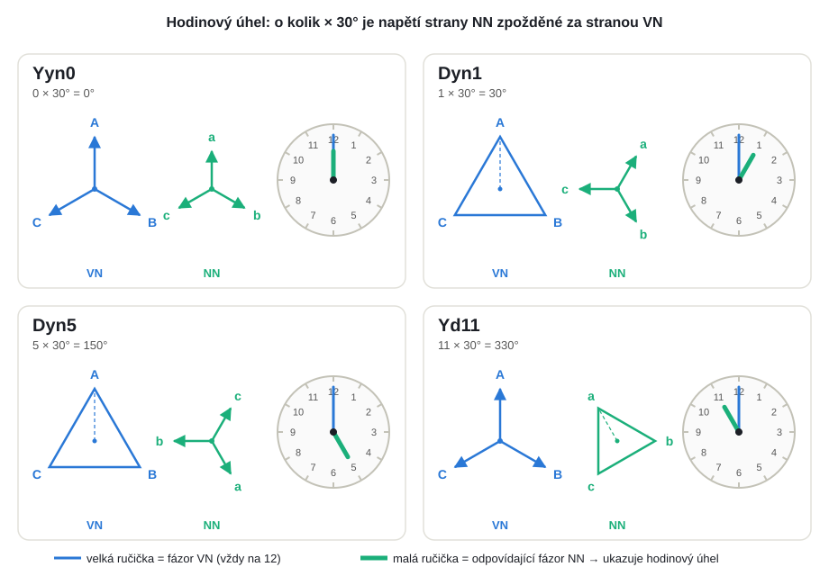
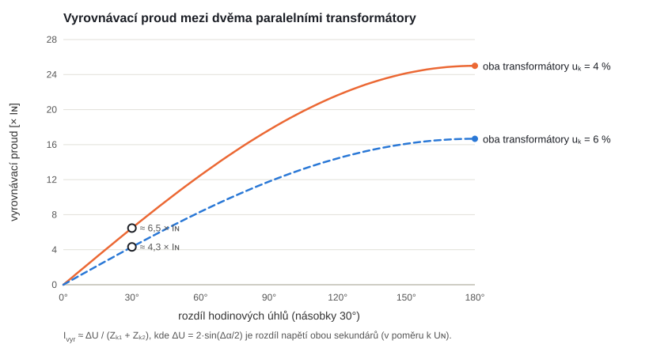

 

# Zapojení vinutí, hodinový úhel, paralelní chod a regulace napětí

Třífázový transformátor má na každé straně tři vinutí a ta můžeme zapojit různými způsoby. Zapojení určuje, jaká napětí transformátor poskytuje (u hvězdy fázové i sdružené, u trojúhelníku jen sdružené), jak snáší nesymetrickou zátěž a také o kolik je výstupní napětí **fázově posunuté** proti vstupnímu. Tento posun vyjadřuje **hodinový úhel**, který musíme znát, když chceme transformátory spojovat paralelně.

## Značení zapojení transformátoru

Způsoby zapojení vinutí (hvězda, trojúhelník, lomená hvězda) jsou popsané v kapitole [Vinutí transformátoru](Transformatory_elektricky_obvod.md). Zapojení obou stran transformátoru spolu s hodinovým úhlem zapisujeme zkratkou, například **Dyn1**:

| Část | Význam | V příkladu Dyn1 |
|---|---|---|
| velké písmeno | zapojení vinutí **vyššího napětí** (VN): **Y** hvězda, **D** trojúhelník, **Z** lomená hvězda | **D**: VN do trojúhelníku |
| malé písmeno | zapojení vinutí **nižšího napětí** (NN): **y**, **d**, **z** | **y**: NN do hvězdy |
| **N** / **n** | uzel hvězdy je vyvedený na svorku (lze připojit nulový vodič) | **n**: vyvedený uzel na straně NN |
| číslo | **hodinový úhel** | **1**: NN je zpožděné o 1 × 30° = 30° |

## Proč vzniká fázový posun

U zapojení **Yy** je každá cívka NN navinutá na stejném sloupku jako cívka VN a napětí na ní je ve fázi s fázovým napětím VN. Fáze se nemění, posun je 0°.

U zapojení **Dy** je cívka VN na sloupku připojená mezi dva vodiče, tedy na **sdružené napětí** (například mezi A a B). Napětí cívky NN na stejném sloupku je s tímto sdruženým napětím ve fázi. Sdružené napětí je ale vůči fázovému napětí posunuté o **30°**. Proto má výstupní fázové napětí vůči vstupnímu fázovému posun 30°. Na tom, jestli trojúhelník uzavřeme jako A–B nebo A–C, závisí, zda posun bude +30°, nebo −30°.

Pokud navíc prohodíme začátky a konce cívek na jedné straně, napětí se obrátí a k posunu se přičte **180°**. Proto existuje Dyn1 i Dyn7, Dyn11 i Dyn5.

## Hodinový úhel

Hodinový úhel udává, **o kolik je fázor napětí strany NN zpožděný za odpovídajícím fázorem strany VN**. Posun je vždy násobkem 30°, a proto ho vyjadřujeme číslem **0 až 11**, stejně jako hodiny na ciferníku (12 hodin × 30° = 360°):

- **velká (minutová) ručička** je fázor napětí VN a ukazuje vždy na **12**,
- **malá (hodinová) ručička** je fázor napětí NN a ukazuje na **číslo hodinového úhlu**.

$$
\large \text{fázový posun} = \text{hodinový úhel} \times 30°
$$

### Vyzkoušejte si: jak zapojení a otočení cívek mění hodinový úhel

V appletu zvolte zapojení vinutí VN a NN a zkuste otočit (prohodit začátek a konec) jednu nebo všechny cívky na straně NN. Cívky na stejném sloupku jádra mají stejnou barvu a číslo.

<iframe
  src="https://tomaschovanec.github.io/ELZ/files/hodinovy_uhel_applet.html"
  width="100%" height="900"
  style="border:0; max-width:900px;"
  loading="lazy"
  title="Hodinový úhel transformátoru">
  </iframe>

Pokud se applet nezobrazí, otevřete ho [v samostatném okně](https://tomaschovanec.github.io/ELZ/files/hodinovy_uhel_applet.html).

### Nejčastější zapojení transformátorů

| Zapojení | Posun | Kde se používá a proč |
|---|---|---|
| **Yyn0** | 0° | malé distribuční transformátory. Nesymetrickou zátěž ale snáší špatně: proud nulového vodiče nemá na straně VN odpovídající protiproud a napětí jednotlivých fází se rozladí |
| **Yzn1**, **Yzn11** | 30°, 330° | menší distribuční transformátory. Lomená hvězda rozdělí zátěž jedné fáze na dva sloupky, takže dobře snáší nesymetrii |
| **Dyn1** | 30° | distribuční transformátory 22/0,4 kV v ČR. Trojúhelník na straně VN vyrovnává nesymetrické zatížení fází na straně NN |
| **Dyn5**, **Dyn11** | 150°, 330° | distribuční transformátory v jiných zemích (např. Německo, Francie) |
| **YNd1**, **YNd11** | 30°, 330° | blokové transformátory v elektrárnách: generátor je připojený na trojúhelník, uzel VN je vyvedený a uzemněný |

Na štítcích skutečných transformátorů najdeme například: olejový distribuční transformátor **630 kVA, 22/0,4 kV, Dyn1** (výrobce BEZ) nebo **630 kVA, 10/0,42 kV, Dyn1, ONAN, uₖ = 4 %** (ELIN, vyrobeno v ČR). Naproti tomu v nabídkách ze zahraničí se objevuje **500 kVA, 10/0,4 kV, Dyn5** (France Transfo) nebo **1000 kVA, 20/0,4 kV, Dy11** (Siemens).

> **Proč má distribuční transformátor na straně VN trojúhelník?** V domácnostech jsou spotřebiče jednofázové, takže fáze nejsou nikdy zatížené stejně. U zapojení Dyn se proud jedné fáze NN přenese do jedné cívky trojúhelníku VN, magnetické toky v jádře zůstanou vyrovnané a napětí jednotlivých fází se nerozladí. Trojúhelník navíc uzavře cestu proudům třetí harmonické, které vznikají při magnetování jádra.

## Paralelní chod transformátorů

Když výkon jednoho transformátoru nestačí nebo když chceme zajistit, aby při poruše či údržbě jednoho z nich dodávka pokračovala, spojujeme transformátory **paralelně**: jejich primární svorky jsou připojené na společné přípojnice VN a sekundární na společné přípojnice NN.

### Podmínky paralelního chodu

| Podmínka | Co se stane, když není splněna |
|---|---|
| 1. **stejná jmenovitá napětí** (stejný převod, i na odbočkách) | sekundární napětí se liší a mezi transformátory teče **vyrovnávací proud** už naprázdno |
| 2. **stejný hodinový úhel** | sekundární napětí jsou fázově posunutá, vyrovnávací proud je **jako při zkratu** |
| 3. **stejný sled fází** a správné propojení svorek | zkrat mezi fázemi |
| 4. **přibližně stejné napětí nakrátko** uₖ (rozdíl nejvýše asi 10 %) | transformátor s menším uₖ se přetěžuje, druhý zůstává nevyužitý |
| 5. **poměr výkonů nejvýše asi 1 : 3** | velmi rozdílné transformátory mají různé poměry R/X a zatížení se dělí nepříznivě |

**Proč na hodinovém úhlu tolik záleží:** sekundární napětí dvou transformátorů posunutá o úhel Δα se liší o napětí $$\Delta U = 2 \cdot U \cdot \sin(\Delta\alpha / 2)$$. Toto rozdílové napětí žene proud přes impedance nakrátko obou transformátorů. Už při rozdílu jedné hodiny (30°) je $$\Delta U \approx 0{,}52 \cdot U$$, tedy přes polovinu napětí:

$$
\large I_{vyr} \approx \frac{\Delta u}{u_{k1} + u_{k2}} \cdot I_N = \frac{52\ \%}{4\ \% + 4\ \%} \cdot I_N \approx 6{,}5 \cdot I_N
$$

Takový proud by tekl i bez jakékoli zátěže a ochrany by transformátory okamžitě odpojily. Transformátory **Dyn1 a Dyn5 proto nikdy nespojíme paralelně**, přestože mají stejné napětí i výkon.

**Příklad – rozdílný převod:** transformátor 22/0,4 kV paralelně s transformátorem 22/0,41 kV (rozdíl 2,5 %), oba s uₖ = 4 %:

$$
\large I_{vyr} \approx \frac{2{,}5\ \%}{4\ \% + 4\ \%} \cdot I_N \approx 0{,}31 \cdot I_N
$$

Mezi transformátory tak naprázdno teče asi třetina jmenovitého proudu. Způsobuje zbytečné ztráty a ubírá z výkonu, který zbývá pro zátěž.

**Příklad – rozdílné uₖ:** dva transformátory 630 kVA, jeden s uₖ = 4 %, druhý s uₖ = 6 %, se zatížením dělí v obráceném poměru napětí nakrátko, tedy 60 % : 40 %. Transformátor se 4 % dosáhne jmenovitého výkonu už při celkovém zatížení 1050 kVA, takže z dvojice o celkovém výkonu 1260 kVA lze bez přetížení využít jen asi 83 %.

## Regulace napětí

Napětí v síti kolísá podle toho, kolik odběratelé zrovna odebírají. Při zatížení navíc vzniká úbytek napětí na samotném transformátoru (viz [náhradní schéma](Transformatory_nahradni_schema.md)) i na vedení. Odběratel ale potřebuje napětí v předepsaných mezích. Napětí proto regulujeme **změnou převodu**, tedy změnou počtu závitů pomocí **odboček** (princip odboček viz [Vinutí transformátoru](Transformatory_elektricky_obvod.md)):

$$
\large U_2 = U_1 \cdot \frac{N_2}{N_1}
$$

Odbočky bývají na **vinutí VN**, protože:

- teče jím menší proud, takže přepínač i kontakty mohou být menší,
- má více závitů, takže jeden závit představuje menší část napětí a regulace může být jemnější.

Na straně VN platí: **více závitů primáru znamená nižší sekundární napětí**. Když je napětí v síti vysoké, přepneme na odbočku s více závity, a naopak.

### Přepínání bez zatížení (PBZ)

Používá se u **distribučních transformátorů 22/0,4 kV**. Transformátor se musí odpojit od sítě, pak se odbočka přepne ručně přepínačem na víku nádoby. Přepíná se zřídka, například při uvedení do provozu nebo po změně poměrů v síti. Typický rozsah je **±2 × 2,5 %**: transformátor 22 ± 2 × 2,5 % / 0,4 kV má pět poloh od −5 % do +5 %.

**Příklad:** Napětí sítě VN v místě transformátoru je trvale 23 kV a transformátor 22/0,4 kV je na střední odbočce. Pak

$$
\large U_2 = 23\,000 \cdot \frac{0{,}4}{22} \approx 418\ \text{V}
$$

Po přepnutí na odbočku +5 % (převod 23,1/0,4 kV) bude $$U_2 = 23\,000 \cdot 0{,}4 / 23{,}1 \approx 398\ \text{V}$$.

### Přepínání pod zatížením (PPZ)

Používá se u **velkých transformátorů v rozvodnách**, například 110/22 kV. Přepínač mění odbočky **za provozu, bez přerušení proudu**. Skládá se ze dvou částí:

- **volič odboček** předem vybere následující odbočku (bez proudu),
- **zatěžovací přepínač** rychle přepne proud na novou odbočku. Při přepnutí jsou na okamžik spojené dvě odbočky a zkrat mezi nimi omezují **přechodové odpory** (nebo tlumivky).

Přepínač ovládá **automatický regulátor napětí**, který měří napětí na straně 22 kV a při odchylce přepne o jeden stupeň. Transformátory 110/22 kV mají typicky převod **110 ± 8 × 2 % / 23 kV**, tedy 17 poloh po 2 %. Distributor tím udržuje napětí v síti 22 kV přibližně v rozmezí 22,8 až 23,8 kV, aby nepřekročilo 24 kV.

> Napětí naprázdno sekundáru bývá o něco vyšší než jmenovité napětí sítě (23 kV místo 22 kV, 0,42 kV místo 0,4 kV). Tím se předem vyrovná úbytek napětí, který vznikne při zatížení.

Při paralelním chodu transformátorů s přepínači odboček musí být oba transformátory vždy **na odpovídajících odbočkách**, jinak mezi nimi teče vyrovnávací proud (viz podmínka č. 1).

## Kontrolní otázky

1. Co znamená označení Dyn1? Popište význam každého znaku.
2. Proč vzniká u zapojení Dy fázový posun 30°?
3. Co je hodinový úhel a jak ho znázorníme pomocí hodin?
4. Jaký fázový posun má transformátor Yd11? A Dyn5?
5. Proč se distribuční transformátory zapojují nejčastěji Dyn? Proč se nehodí Yyn pro nesymetrickou zátěž?
6. Vyjmenujte podmínky paralelního chodu transformátorů.
7. Co se stane, když paralelně spojíme transformátory Dyn1 a Dyn11? Odhadněte vyrovnávací proud pro uₖ = 6 %.
8. Proč se odbočky pro regulaci napětí umisťují na vinutí VN?
9. Napětí v síti je trvale 21,5 kV. Na kterou odbočku přepneme transformátor 22 ± 2 × 2,5 % / 0,4 kV, aby sekundární napětí bylo co nejblíže 400 V?
10. Jaký je rozdíl mezi přepínáním odboček bez zatížení a pod zatížením? Kde se které používá?

## Zdroje příkladů

- Štítkové údaje transformátorů BEZ, ELIN, France Transfo a Siemens: inzeráty na [machineseeker](https://www.machineseeker.ie/bez-630kva+22%2F0%2C4kv/i-20853507) a [machineseeker – ELIN](https://www.machineseeker.nz/elin-630kva+10%2F0%2C42kv+dyn1/i-20827632)
- Regulace napětí v distribuční soustavě (110 ± 8 × 2 % / 23 kV, rozsah 22,8 až 23,8 kV, odbočky 22 ± 2 × 2,5 % / 0,4 kV): [VUT Brno – závěrečná práce](https://dspace.vut.cz/server/api/core/bitstreams/231d04a6-e202-4b4c-b186-0bc24f761dcc/content)

### [Zpět na obsah](../README.md)
