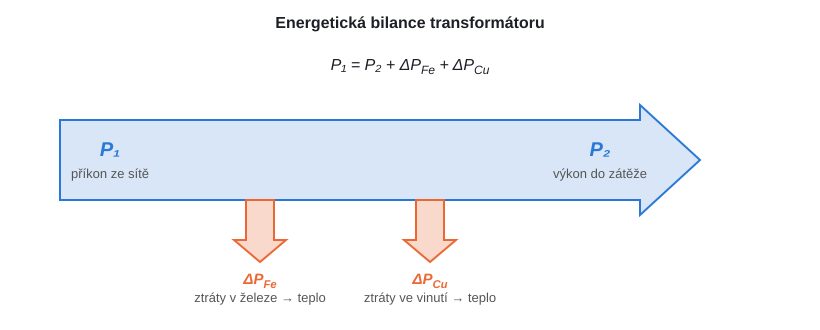
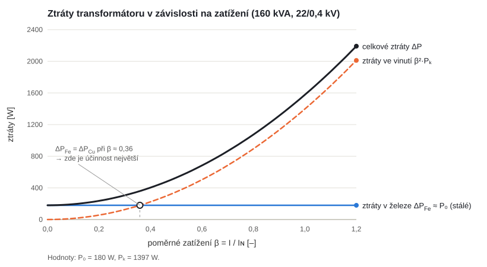
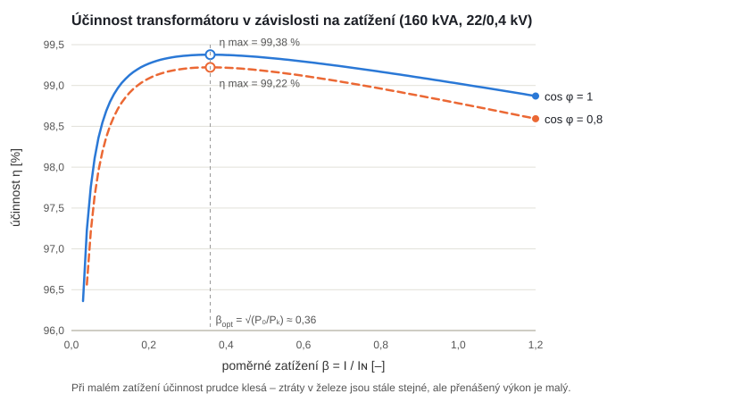

 

# Ztráty, účinnost a chlazení transformátoru

Transformátor patří k nejúčinnějším strojům vůbec. Velké transformátory mají účinnost přes 99 %. Přesto se ztrátami zabýváme podrobně: transformátor je připojený k síti nepřetržitě, 8760 hodin ročně, a v síti jich pracují desetitisíce. I malé ztráty se tak sčítají do velkého množství energie. Navíc se všechny ztráty mění v **teplo**, které musíme z transformátoru odvést.

## Energetická bilance

Příkon $$P_1$$, který transformátor odebírá ze sítě, se rozdělí na výkon do zátěže $$P_2$$ a na ztráty:

$$
\large P_1 = P_2 + \Delta P_{Fe} + \Delta P_{Cu}
$$

Ztráty dělíme na dvě skupiny, které přesně odpovídají prvkům [náhradního schématu](Transformatory_nahradni_schema.md):

| | Ztráty v železe $$\Delta P_{Fe}$$ | Ztráty ve vinutí $$\Delta P_{Cu}$$ |
|---|---|---|
| kde vznikají | v magnetickém obvodu (jádře) | ve vodičích primárního a sekundárního vinutí |
| prvek náhradního schématu | $$R_{Fe}$$ | $$R_1$$, $$R_2'$$ |
| na čem závisí | na **napětí** (magnetickém toku) a frekvenci | na **proudu**, tedy na zatížení ($$\sim I^2$$) |
| při provozu | **stálé**: jsou stejné naprázdno i při plném zatížení | **proměnné**: rostou s druhou mocninou zatížení |
| jak je změříme | měřením **naprázdno**: $$P_0 \approx \Delta P_{Fe}$$ | měřením **nakrátko**: $$P_k \approx \Delta P_{Cu}$$ |
| na štítku / v katalogu | ztráty naprázdno $$P_0$$ | ztráty nakrátko (při zatížení) $$P_k$$ |

## Ztráty v železe

Ztráty v železe vznikají ve střídavém magnetickém poli jádra. Mají dvě složky:

- **Hysterezní ztráty:** při každé periodě se magnetické domény v plechu přemagnetují tam a zpět. Spotřebovaná energie odpovídá ploše hysterezní smyčky a ztráty rostou úměrně frekvenci. Snižují se použitím **magneticky měkké** oceli s úzkou hysterezní smyčkou (křemíková ocel, orientované plechy).
- **Ztráty vířivými proudy:** proměnný tok indukuje přímo v železe jádra napětí, které v něm vyvolá vířivé proudy, a ty jádro zahřívají. Ztráty rostou s druhou mocninou frekvence i tloušťky plechu. Snižují se tím, že je jádro **složené z tenkých plechů** (asi 0,23 až 0,35 mm) navzájem izolovaných, a přidáním křemíku, který zvyšuje měrný odpor oceli. Podrobněji viz kapitola [Magnetický obvod transformátoru](Transformatory_magneticky_obvod.md).

Obě složky rostou přibližně s druhou mocninou magnetické indukce, tedy i napětí. Při jmenovitém napětí jsou ztráty v železe **stálé**, ať transformátor zatížíme jakkoli.

> **Zajímavost:** nejnižší ztráty naprázdno mají transformátory s jádrem z **amorfní oceli**. Je to slitina, která nemá krystalickou strukturu, a proto se velmi snadno přemagnetovává. Je ale dražší a hůře se zpracovává.

## Ztráty ve vinutí

Ztráty ve vinutí (často se jim říká ztráty v mědi, i když vinutí může být hliníkové) jsou **Jouleovy ztráty** v odporu vodičů:

$$
\large \Delta P_{Cu} = R_1 \cdot I_1^2 + R_2 \cdot I_2^2 = R_k \cdot I_1^2
$$

K nim se přidávají menší **přídavné ztráty**: vířivé proudy ve vodičích vinutí a v kovových částech (nádoba, svorníky), které vyvolává rozptylový tok.

Protože odpor vodičů roste s teplotou, udávají se ztráty nakrátko vždy při **referenční teplotě**, u olejových transformátorů 75 °C.

### Ztráty v závislosti na zatížení

Označíme-li poměrné zatížení $$\beta = I / I_N$$ (β = 1 je jmenovité zatížení, β = 0,5 poloviční), pak:

$$
\large \boxed{\Delta P = P_0 + \beta^2 \cdot P_k}
$$

Graf platí pro skutečný olejový distribuční transformátor **160 kVA, 22/0,4 kV** (P₀ = 180 W, Pₖ = 1397 W). Při malém zatížení převažují ztráty v železe, při velkém ztráty ve vinutí. Při polovičním zatížení jsou ztráty ve vinutí jen čtvrtinové: $$0{,}5^2 \cdot 1397 \approx 349\ \text{W}$$.

## Účinnost

Účinnost je poměr výkonu a příkonu:

$$
\large \eta = \frac{P_2}{P_1} = \frac{P_2}{P_2 + \Delta P_{Fe} + \Delta P_{Cu}}
$$

Účinnost transformátoru **neměříme přímo** (rozdíl $$P_1 - P_2$$ by byl menší než chyba měřicích přístrojů). Počítáme ji ze ztrát změřených naprázdno a nakrátko.

### Maximální účinnost

Účinnost je největší, když jsou **proměnné ztráty rovny stálým**:

$$
\large \beta^2 \cdot P_k = P_0 \quad \Rightarrow \quad \boxed{\beta_{opt} = \sqrt{\frac{P_0}{P_k}}}
$$

Distribuční transformátory bývají v průměru zatížené jen částečně. Proto se navrhují s **malými ztrátami naprázdno** a maximum účinnosti mají kolem 30 až 50 % jmenovitého zatížení.

**Příklad:** Transformátor 160 kVA, 22/0,4 kV, P₀ = 180 W, Pₖ = 1397 W.

- jmenovité zatížení, cos φ = 1: $$P_2 = 160\ \text{kW}$$, $$\Delta P = 180 + 1397 = 1577\ \text{W}$$, $$\eta = \dfrac{160\,000}{161\,577} \approx 99{,}02\ \%$$
- jmenovité zatížení, cos φ = 0,8: $$P_2 = 128\ \text{kW}$$, $$\eta = \dfrac{128\,000}{129\,577} \approx 98{,}78\ \%$$
- optimální zatížení: $$\beta_{opt} = \sqrt{180/1397} \approx 0{,}36$$, tedy asi 58 kVA. Při cos φ = 1 je $$\eta_{max} \approx 99{,}38\ \%$$
- naprázdno: $$P_2 = 0$$, takže $$\eta = 0$$, ale transformátor stále odebírá 180 W

### Roční ztráty energie

Ztráty naprázdno vznikají po celou dobu, kdy je transformátor připojený k síti:

$$
\large W_0 = P_0 \cdot 8760\ \text{h} = 180\ \text{W} \cdot 8760\ \text{h} \approx 1577\ \text{kWh za rok}
$$

To je zhruba roční spotřeba elektřiny menšího bytu, a to jen za jeden transformátor, který nic nenapájí. Proto Evropská unie nařízením o **ekodesignu** (nařízení Komise 2019/1783, druhá etapa „Tier 2“ platná od 1. 7. 2021) stanovuje maximální povolené ztráty naprázdno i nakrátko pro nově prodávané transformátory. Transformátor 160 kVA z našeho příkladu je navržený právě podle těchto požadavků.

## Chlazení transformátoru

Všechny ztráty se mění v teplo. Kdyby se neodvádělo, teplota vinutí by rostla a **izolace by rychle stárla**. Životnost izolace je silně závislá na teplotě: podle často uváděného pravidla zvýšení trvalé teploty zhruba o 6 až 8 K zkrátí její životnost přibližně na polovinu. Teplota je proto hlavní veličina, která omezuje výkon transformátoru. Transformátor stejné velikosti s lepším chlazením může přenášet větší výkon.

Teplo vzniká v jádře a ve vinutí. Odtud ho **chladivo** (vzduch nebo olej) přenáší na povrch transformátoru a z povrchu do okolního vzduchu (nebo vody).

### Suché transformátory

Vinutí je zalité v pryskyřici nebo izolované lakem a chladí se přímo **vzduchem**. Používají se tam, kde by olej představoval riziko požáru nebo úniku: v budovách, nemocnicích, obchodních centrech, metru. Izolace snese vyšší teploty než olejová (běžně teplotní třída F, tj. 155 °C, nebo H, tj. 180 °C), ale chlazení vzduchem je méně účinné. Proto jsou suché transformátory větší a dražší.

### Olejové transformátory

Jádro a vinutí jsou ponořené v nádobě s **transformátorovým olejem**, který má dvě funkce:

1. **izoluje**: má mnohem větší elektrickou pevnost než vzduch,
2. **chladí**: ohřátý olej stoupá vzhůru, předá teplo stěnám nádoby nebo radiátorům, ochladí se a klesá zpět dolů. Vzniká přirozený oběh.

Olej při ohřátí zvětšuje objem. Podle toho, jak se s tím transformátor vyrovná, rozlišujeme:

- **transformátory s konzervátorem**: nad nádobou je vyrovnávací nádržka (konzervátor), do které olej při ohřátí vytéká. V potrubí mezi nádobou a konzervátorem bývá **plynové (Buchholzovo) relé**, které zachytí plyny vznikající při vnitřní poruše a transformátor odpojí,
- **hermetické transformátory**: nádoba je zcela uzavřená a má zvlněné (vlnovcové) stěny, které se při změně objemu oleje pruží. Olej nepřichází do styku se vzduchem, a proto méně stárne. Dnes se tak vyrábí většina distribučních transformátorů.

### Značení způsobu chlazení

Způsob chlazení olejových transformátorů se označuje **čtyřmi písmeny**:

| Pozice | Význam | Písmena |
|---|---|---|
| 1. | chladivo uvnitř (ve styku s vinutím) | **O** minerální olej, **K** nehořlavá kapalina, **L** kapalina bez měřitelného bodu hoření |
| 2. | oběh vnitřního chladiva | **N** přirozený, **F** nucený (čerpadlem), **D** nucený a řízený přímo do vinutí |
| 3. | chladivo vně | **A** vzduch (air), **W** voda (water) |
| 4. | oběh vnějšího chladiva | **N** přirozený, **F** nucený (ventilátory, čerpadlem) |

Nejčastější způsoby chlazení:

| Označení | Popis | Použití |
|---|---|---|
| **ONAN** | olej i vzduch proudí přirozeně | distribuční transformátory, menší výkony |
| **ONAF** | olej proudí přirozeně, na radiátory fouká vzduch z ventilátorů | střední a velké transformátory |
| **OFAF** | olej žene čerpadlo přes chladiče, vzduch fouká ventilátory | velké síťové transformátory |
| **ODAF** | olej je čerpadlem směrován přímo do kanálků ve vinutí | největší transformátory |
| **OFWF** | olej předává teplo vodě ve výměníku | elektrárny, podzemní stanice |
| **AN**, **AF** | suchý transformátor, vzduch přirozeně / nuceně (ventilátory) | suché transformátory v budovách |

Velké transformátory mají často **dva stupně chlazení**, například **ONAN/ONAF**: při menším zatížení stačí přirozené chlazení a při velkém zatížení se automaticky zapnou ventilátory. Na štítku jsou pak uvedené dva jmenovité výkony, pro každý způsob chlazení jeden.

## Kontrolní otázky

1. Jaké dvě skupiny ztrát v transformátoru rozlišujeme? Na čem závisí každá z nich?
2. Čím se snižují ztráty hysterezí a čím ztráty vířivými proudy?
3. Proč je jádro složené z tenkých izolovaných plechů?
4. Jak se změní ztráty ve vinutí, když zatížení klesne na polovinu?
5. Při jakém zatížení má transformátor největší účinnost? Odvoďte vzorec.
6. Transformátor 630 kVA má P₀ = 600 W a Pₖ = 6000 W. Vypočítejte účinnost při jmenovitém zatížení a cos φ = 0,9 a zatížení, při kterém je účinnost největší.
7. Proč se u distribučních transformátorů klade důraz hlavně na malé ztráty naprázdno?
8. Jaké dvě funkce má olej v transformátoru?
9. Co znamená označení ONAF? Čím se liší od ONAN?
10. K čemu slouží plynové (Buchholzovo) relé?

## Zdroje příkladů

- Transformátor 160 kVA, 22/0,4 kV, P₀ = 180 W, Pₖ = 1397 W: [ZČU – projekt ENVITRAFOL](https://envitrafol.zcu.cz/trafo_envitrafol.pdf)
- Nařízení o ekodesignu transformátorů: [Siemens Energy – Ecodesign leaflet](https://assets.siemens-energy.com/dam/ae1397f8-02a9-453c-b640-b0580096a0fd/EcodesignLeaflet-pdf_Original%20file.pdf)

### [Zpět na obsah](../README.md)
